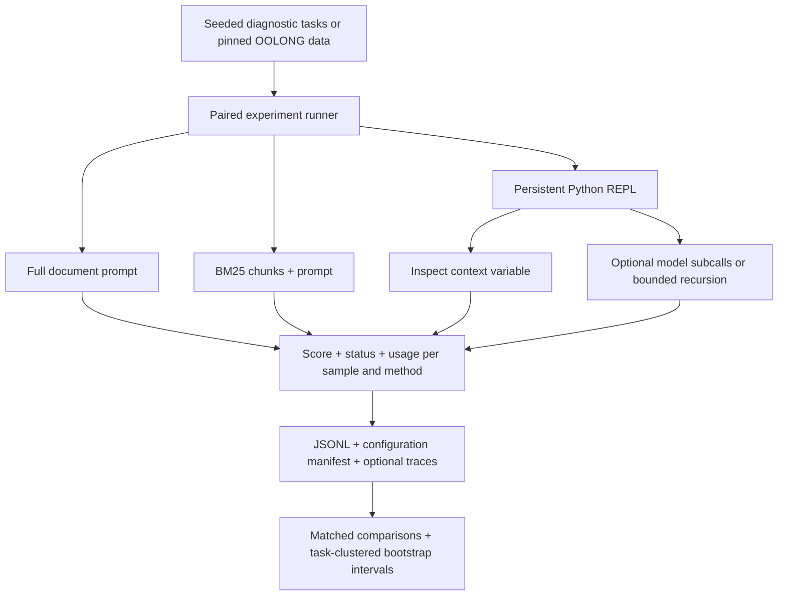

# Context-Rot

**When a document gets longer, is it better to read it all, retrieve a few chunks, or inspect it through code?**

Context-Rot is a Python evaluation project comparing these approaches on long-context tasks. It separates sparse lookup, where one fact answers the question, from dense aggregation, where the answer depends on many records.

The current implementation evaluates a Recursive Language Model (RLM): the document stays in a Python variable, and the model writes code to inspect it rather than receiving the whole document in its prompt.

[Recorded results](#recorded-results) · [Run a model experiment](#run-a-model-experiment) · [Analyze a saved run](#analyze-a-saved-run) · [Source map](#source-map)

## What is implemented

| Method | How it reads the document |
| --- | --- |
| `fullcontext` | Sends the complete document in one prompt; refuses inputs above its configured limit rather than truncating them. |
| `rag` | Retrieves BM25-ranked chunks, then makes one generation call. |
| `rlm_symbolic` | Uses the persistent Python REPL without model subcalls. |
| `rlm_depth0` | Uses the REPL and ordinary model subcalls, but cannot recurse. |
| `rlm_depth1` | Also permits one level of recursive RLM calls. |

All methods use the same generation client. The runner supports synthetic single-needle lookup (S-NIAH), dense counting, section-wise recursive aggregation, and a loader for a pinned OOLONG dataset revision.



The runner shuffles method order deterministically within each sample, writes each result immediately, and records configuration hashes for resumable runs. Analysis reports coverage separately and compares only matched successful samples.

## Recorded results

A locally recorded dense-counting run contains 30 cases per method: 10 seeds at each of 200, 1,000, and 5,000 records. It used `openai-codex/gpt-5.6-luna` through OMP, with low thinking. These are synthetic diagnostics, not a broad benchmark leaderboard.

| Method | Successful / attempted | Exact match |
| --- | ---: | ---: |
| Full context | 30 / 30 | 36.7% |
| BM25 RAG | 30 / 30 | 0.0% |
| RLM depth 0 | 30 / 30 | 86.7% |
| RLM depth 1 | 30 / 30 | 86.7% |

This snapshot was calculated with `analysis.analyze` from the local `dense_luna_scale_30.jsonl` run. Generated results and manifests stay under the git-ignored `results/` directory; they are not bundled with the repository. Exact match is distinct from the partial-credit `score` field. The 30 cases reuse 10 task seeds across sizes; they are not 30 independent task clusters.

Here, inspecting the document through code did better on exact counting than retrieving a subset of records. Equal aggregate accuracy at depths 0 and 1 does not establish a benefit from recursion.

Missing, failed, or context-limit rows are not evidence of incorrect answers on completed tasks. Check coverage and paired sample counts before comparing runs. This small dataset does not establish a universal winner or a general rate of context degradation.

> The [PDF report](report/context_rot_report.pdf) and older local JSON results describe the retired Gemini/retrieval-first implementation. Keep them separate from the current JSONL diagnostics.

## Run a model experiment

Model runs require **Python 3.11+**, the Python dependencies, and a **separately installed, authenticated OMP CLI**. The current client invokes `omp` print sessions using subscription access; `requirements.txt` does not install OMP, and an API key alone is not this project's setup path.

1. Create a virtual environment with `python -m venv .venv`.
2. Activate it with `.venv\Scripts\Activate.ps1` in PowerShell, or `source .venv/bin/activate` on macOS/Linux.
3. Install dependencies:

```sh
python -m pip install -r requirements.txt
```

Ensure `omp` is on `PATH`, or set `OMP_EXECUTABLE` to its executable path. Your authenticated subscription must support the selected model. Review [config.yaml](config.yaml) for model, retrieval, and controller limits; [src/config.py](src/config.py) defines environment overrides such as `MODEL_GENERATION` and `SUBSCRIPTION_CALL_LIMIT`.

A small synthetic run, which makes real model calls:

```sh
python -m experiments.runner dense --tasks 1 --record-counts 200 --methods fullcontext rag rlm_depth0 rlm_depth1 --output results/local_dense.jsonl
```

The default process-local subscription cap is 40 calls. RLM iterations and subcalls share this client, so larger runs can stop before all cells finish. Saved manifests retain the limits used for their runs; the recorded dense run used a cap of 400, not today's default.

RLM executes model-generated Python with restricted builtins in the local process. This is not an isolated security sandbox. Use trusted inputs and an appropriate execution environment. The OOLONG option also needs dataset access; the synthetic example above does not download a benchmark dataset.

## Analyze a saved run

Analysis uses only Python's standard library and makes no model calls. Result files are generated locally, so first run an experiment or provide your own saved run. To analyze the output of the example above:

```sh
python -m analysis.analyze results/local_dense.jsonl --metric exact_match --baseline rag --condition-field num_records
```

It prints JSON with coverage, matched comparisons, and bootstrap intervals when multiple task clusters are available. Add `--output results/local_dense_analysis.json` to save it. Use `--metric score` to inspect the benchmark's partial-credit metric instead.

## Source map

- [experiments/runner.py](experiments/runner.py): task generation, paired execution, scoring, and optional trace export.
- [src/controllers/](src/controllers/): full-context, BM25, and persistent-REPL implementations.
- [benchmarks/diagnostic.py](benchmarks/diagnostic.py): diagnostic workloads and OOLONG loading/scoring.
- [analysis/](analysis/): JSONL summaries and task-clustered paired comparisons.
- [src/trace/](src/trace/): JSONL tracing and HTML trace export; use the runner's `--trace-dir` option to generate local traces.
- [tests/](tests/): controller, runner, persistence, and analysis tests.
